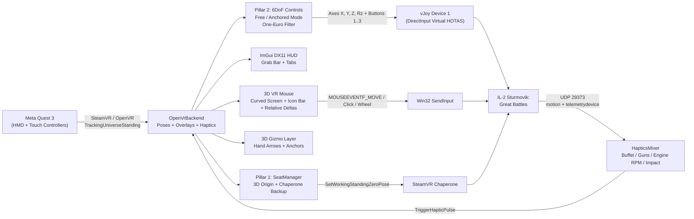

# IL-2 VR QoL Companion (`v0.9.1`)


[](LICENSE)
[](https://ko-fi.com/jvtarran)


**[🇺🇸 Full English Documentation](#-english-guide)** · **[🇧🇷 Documentação Completa em Português (BR)](#-guia-em-português-br)**

*External VR Quality of Life, 6DoF Virtual Flight Controls (VTOL-VR style), Cockpit Seat Positioning, VR Menu Raycaster Mouse, and Telemetry Controller Haptics companion for **IL-2 Sturmovik: Great Battles** (Meta Quest 3 / SteamVR).*

*Companion app externo de Qualidade de Vida, Controles Virtuais 6DoF (estilo VTOL VR), Posicionamento de Cockpit, Mouse VR e Háptica por Telemetria para **IL-2 Sturmovik: Great Battles** (Meta Quest 3 / SteamVR).*

> [!IMPORTANT]
> **100% External / Zero Game-File Modification:** The companion runs as a standalone external process using **OpenVR Overlays**, **vJoy** (virtual HOTAS), **Win32 `SendInput`**, and official UDP telemetry output (`data/startup.cfg`). Zero IL-2 binaries or `.gtp` packages are touched, preserving full compatibility with game patches and multiplayer integrity checks.

---

## Support Development / Apoie o Desenvolvimento

[-FF5E5B?style=for-the-badge&logo=ko-fi&logoColor=white)](https://ko-fi.com/jvtarran)

- **English (`v1.0` Goal on [ko-fi.com/jvtarran](https://ko-fi.com/jvtarran)):** **IL-2 VR QoL Companion** is 100% free and open source under GNU GPLv3 — with no paywalls or locked features. Bringing this companion to **`v1.0`** represents dozens of engineering hours across 6DoF flight math, OpenVR overlays, DirectInput-safe VR menu interaction, and live UDP telemetry haptics. Voluntary donations help fund the work hours behind **`v1.0`**; once the `v1.0` goal is funded, work expands into major **post-v1 improvements** and new VR cockpit features. Non-financial support (GitHub ⭐ stars, VR flight-test feedback, translations, and pull requests) is equally appreciated.
- **Português (`Meta v1.0` em [ko-fi.com/jvtarran](https://ko-fi.com/jvtarran)):** O projeto é 100% gratuito e open-source sob GNU GPLv3. Doações voluntárias ajudam a remunerar as horas de desenvolvimento investidas na **`v1.0`**; assim que a meta da `v1.0` for financiada, o desenvolvimento avança para **grandes melhorias pós-v1** e novos recursos de cockpit VR.

---

## 🇺🇸 English Guide

### Table of Contents

- [Architecture Overview](#architecture-overview)
- [1. Requirements & Quick Start](#1-requirements--quick-start)
- [2. Quest 3 Controller Map & Global Windows Hotkeys](#2-quest-3-controller-map--global-windows-hotkeys)
- [3. How Each Module Works & How to Interact](#3-how-each-module-works--how-to-interact)
  - [Pillar 1 — Cockpit Seat Positioning & 3D VR Origin](#pillar-1--cockpit-seat-positioning--3d-vr-origin)
  - [Floating VR HUD & Quest-Style Grab Bar](#floating-vr-hud--quest-style-grab-bar)
  - [Pillar 2 — 6DoF Virtual Stick & Throttle (Free Mode vs. Anchored Mode)](#pillar-2--6dof-virtual-stick--throttle-free-mode-vs-anchored-mode)
  - [IL-2 Auto-Bind & Automatic vJoy Profile Sync](#il-2-auto-bind--automatic-vjoy-profile-sync)
  - [3D Hand Gizmo Arrows & Live Euler Readout](#3d-hand-gizmo-arrows--live-euler-readout)
  - [DirectInput-Safe VR Menu Mouse & Curved Screen Grab Bar (`v0.8.0` / `v0.8.1`)](#directinput-safe-vr-menu-mouse--curved-screen-grab-bar-v080--v081)
  - [IL-2 UDP Telemetry Controller Haptics (`v0.8.2` / `v0.8.3`)](#il-2-udp-telemetry-controller-haptics-v082--v083)
  - [Modular Languages (`i18n` — `en-US` & `pt-BR`)](#modular-languages-i18n--en-us--pt-br)
- [4. Building from Source & Running Tests](#4-building-from-source--running-tests)
- [5. Repository Structure](#5-repository-structure)
- [6. Dual Licensing & Commercial Integration](#6-dual-licensing--commercial-integration)

---

### Architecture Overview



---

### 1. Requirements & Quick Start

> Also included as a Notepad-friendly plain text guide in [`HOW_TO_RUN.txt`](HOW_TO_RUN.txt).

#### Prerequisites
1. **Windows 10/11 (64-bit)**.
2. ***IL-2 Sturmovik: Great Battles*** running in VR via **SteamVR / OpenVR** (Quest Link, Air Link, Virtual Desktop, or Steam Link).
3. **[vJoy](https://github.com/BrunnerInnovation/vJoy)** installed with **Device 1** enabled (`X`, `Y`, `Z`, `Rz` axes + buttons).
4. If your vJoy Device 1 only has partial axes active, right-click **[`repair_vjoy_axis.bat`](repair_vjoy_axis.bat)** -> **Run as Administrator** once (or click the red `ENABLE VJOY AXES (Admin)` button in the VR HUD).

#### How to Run
1. Double-click **[`initiate_il2_vr_qol_mod.bat`](initiate_il2_vr_qol_mod.bat)** from Windows Explorer *(runs in the interactive Windows desktop session so VR Menu Mouse can send `SendInput` events to IL-2)*.
2. Start **SteamVR** and ***IL-2 Sturmovik: Great Battles***.
3. The companion automatically connects to `SteamVR` and `Il-2.exe`:
   - Acquires **vJoy Device 1** (and automatically re-acquires if temporarily lost).
   - Scans `data/input`, identifies vJoy's actual device index (`joy0`, `joy1`, etc.) in `devices.txt`, and keeps profiles synchronized.
   - Enables UDP telemetry (`[KEY = motiondevice]` & `[KEY = telemetrydevice]` on port `29373`) in `data/startup.cfg` after saving a backup (`startup.cfg.bak_il2vr`). *(If IL-2 was already running when patched, restart IL-2 once — a visible banner prompts you automatically).*
4. Closing the companion automatically restores your original SteamVR Chaperone zero pose.

---

### 2. Quest 3 Controller Map & Global Windows Hotkeys

| Quest 3 Input | Action | When / Where |
|---|---|---|
| **`Hold L3` (`0.65 s`)** | **Show / Hide** the floating VR HUD | Anytime |
| **`3x R3`** *(Right thumbstick triple-click)* | Toggle **6DoF Flight Mode ↔ Edit 3D Origin** | Anytime |
| **`Hold L3 + R3`** *(`Together 0.65 s`)* | **Recenter VR Origin** at current head pose | Anytime |
| **`Hold R3` (`0.65 s`)** | **Toggle VR Raycaster Mouse** over game menus | Menus / Cockpit |
| **`Right Grip` / `Left Grip`** *(Flight)* | Hold **6DoF Virtual Stick** / **Virtual Throttle Lever** | In flight |
| **`Right Trigger`** *(Held)* | **Fire All Guns** (`vJoy Btn 1`) | In flight |
| **`Right A`** *(Held / `2x` / `Hold 0.5 s`)* | **Cannons (`vJoy Btn 2`)** / **Drop Bombs (`B`)** / **Rockets (`R`)** | In flight |
| **`Right B`** *(`1x` / `2x` / `Hold 0.6 s`)* | **Landing Gear (`G`)** / **Airbrakes (`RAlt+B`)** / **Canopy (`RAlt+C`)** | In flight |
| **`Left Trigger`** *(Held)* | **Wheel Brakes** (`vJoy Btn 3`) | In flight |
| **`Left X`** *(`1x` / `2x`)* | **Flaps Down (`F`)** / **Flaps Up (`LShift+F`)** | In flight |
| **`Left Y`** *(`1x` / `Hold 0.6 s`)* | **Parking Brakes (`LShift+/`)** / **Engine Start-Stop (`E`)** | In flight |
| **`Left X + Left Y`** *(`Hold Together 0.65 s`)* | **Bail Out / Eject (`LCtrl+E`)** *(accidental-safe)* | In flight |
| **`Right A + Right B`** *(`Together`)* | **Reload All Guns (`LAlt+R`)** | In flight |
| **`Left Trigger + Right A`** *(`Together`)* | **Bomb Bay Doors (`N`)** | In flight |
| **Trigger / Grip on HUD bottom Grab Bar** | **Reposition HUD** in 3D space *(Thumbstick Y adjusts depth)* | While HUD is visible |
| **VR Mouse Screen Icon Bar** *(Move / `✕`)* | Reposition flat/curved screen or Close VR Mouse | VR Mouse Mode (`Hold R3`) |

<details>
<summary>⌨️ Global Windows Hotkeys (work even while IL-2 has window focus)</summary>

| Shortcut | Action |
|---|---|
| `Ctrl + Alt + O` / `M` / `F1` | Show / Hide VR HUD |
| `Ctrl + Alt + R` / `Home` / `NumPad 5` | Recenter VR origin on current head pose |
| `Ctrl + Alt + 0` / `Backspace` / `NumPad 0` | Reset manual offsets |
| `Ctrl + Alt + T` | Quick visual height test (`+25 cm`) |
| `Ctrl + Alt + W / S / A / D` *(or Arrows / NumPad)* | Nudge cockpit Up/Down/Left/Right (normal step) |
| `Ctrl + Alt + I / K` *(or PageUp / PageDown)* | Nudge cockpit Forward/Back (normal step) |
| `Ctrl + Alt + Q / E` *(or `<` / `>`)* | Rotate Yaw Left / Right |
| Hold **`Shift`** (`Ctrl + Alt + Shift + ...`) | Same nudge in **Fine Step (`2 mm / 0.5°`)** |

</details>

---

### 3. How Each Module Works & How to Interact

#### Pillar 1 — Cockpit Seat Positioning & 3D VR Origin
*Core files: [`SeatManager.h`](src/seat/SeatManager.h), [`SeatManager.cpp`](src/seat/SeatManager.cpp), [`OpenVrBackend.cpp`](src/vr/OpenVrBackend.cpp)*

- **Why:** On Quest 3 over OpenVR, IL-2 runs in `TrackingUniverseStanding`. Writing `SeatedZeroPose` directly causes `~180°` yaw jumps. `SeatManager` exclusively reads/writes `WorkingStandingZeroPose`, backs up your original SteamVR Chaperone on connect, and translates along the pilot's horizontal facing vector (`Yaw`).
- **How to use:**
  1. Sit comfortably and **hold `L3 + R3` (`0.65 s`)** *(or press HUD `Recenter`)* to snap the cockpit origin to your head.
  2. To lean closer to instruments, raise your seat over the cowling, or center laterally: **triple-click Right Thumbstick (`3x R3`)** (confirmed by a haptic pulse -> `EDIT 3D ORIGIN`).
  3. Hold either **`Grip`** in mid-air and drag the world around you (`Yaw` remains locked so the horizon never tilts).
  4. Triple-click **`R3`** again to lock and return to flight.

#### Floating VR HUD & Quest-Style Grab Bar
*Core files: [`main.cpp`](src/app/main.cpp), [`MathTypes.cpp`](src/core/MathTypes.cpp)*

- Renders simultaneously in a Windows desktop debug window and a **DX11 OpenVR overlay** (`0.62 m` default width), with automatic laser raycasting from whichever hand aims at the panel.
- **How to use:**
  - **Hold `L3` (`0.65 s`)** anytime (or click **`Hide / Close VR HUD`** inside the panel) to toggle HUD visibility without consuming flight buttons.
  - Hold **`Trigger` or `Grip`** on the bottom blue bar (`GRAB BAR HERE`) to move the HUD anywhere in your cockpit; push **Thumbstick Up/Down** while holding to adjust distance (`0.35 m` to `1.60 m`). Click **`Panel in Front`** in Pillar 1 anytime to summon it back.

#### Pillar 2 — 6DoF Virtual Stick & Throttle (`Free Mode` vs. `Anchored Mode`)
*Core files: [`MathTypes.h`](src/core/MathTypes.h), [`MathTypes.cpp`](src/core/MathTypes.cpp), [`main.cpp`](src/app/main.cpp)*

Controller 6DoF motion is projected into the pilot's horizontal frame, smoothed with adaptive **One-Euro filters** (fast response in dogfights, zero hand tremor when still), and shaped with configurable deadzone and exponential curves into **vJoy**.

1. **`Free Mode`** *(VTOL VR style default)*:
   - Hold **`Right Grip`** anywhere comfortable (chair armrest, thigh, mid-air): the initial grab point/orientation becomes neutral (`0, 0`). Moving/tilting commands **Roll (`X`)** & **Pitch (`Y`)**, and optional wrist twist drives **Rudder (`Rz`)**. Releasing returns to center.
   - Hold **`Left Grip`** anywhere to push/pull **Throttle (`Z`)**; releasing **latches** throttle at its percentage with subtle haptic detents at `0%`, `50%`, and `100%`.
   - Physical thumbsticks remain active for trim / rudder / throttle fine tuning.
2. **`Anchored Mode`** *(Fixed 3D Cockpit Controls)*:
   - Places fixed 3D Stick and Throttle anchors inside your cockpit (`config/controls.anchors.json`).
   - Gives a gentle **tactile proximity cue** within **`14 cm`** of either control.
   - Click **`Position Controls`** to enter calibration (neutralizes vJoy flight axes so the aircraft stays safe), drag/rotate both 3D anchors onto the in-game cockpit stick and throttle using Right/Left Grip, then click **`Save Anchors & Return to Flight`**.

#### IL-2 Auto-Bind & Automatic vJoy Profile Sync
*Core files: [`VJoyClient.cpp`](src/output/VJoyClient.cpp), [`main.cpp`](src/app/main.cpp)*

- In IL-2 *Settings -> Key Mapping*, select an axis (`Pitch`, `Roll`, `Yaw`, `Throttle`) and click **`Bind Roll X` / `Pitch Y` / `Throttle Z` / `Rudder Rz`** in Pillar 2. The companion sends a clean **4.2-second single-axis sweep** (`0 -> +100% -> -100% -> 0`) with zero cross-axis interference.
- Automatically updates `joyN` bindings inside `data/input/` on startup/game exit via `Sync IL-2` if physical USB devices shift Windows joystick IDs.

#### 3D Hand Gizmo Arrows & Live Euler Readout
*Core files: [`OpenVrBackend.cpp`](src/vr/OpenVrBackend.cpp), [`MathTypes.cpp`](src/core/MathTypes.cpp)*

- In **`3D Gizmo & Mouse`**: toggle 3D orientation overlays attached to both controllers (`Forward -Z` cyan, `Right +X` gold/red), keep cockpit anchor markers visible in flight, and monitor real-time `Pitch / Roll / Yaw` Euler angles (`extractEulerAnglesDeg`) for both hands.

#### DirectInput-Safe VR Menu Mouse & Curved Screen Grab Bar (`v0.8.0` / `v0.8.1`)
*Core files: [`KeyboardInjector.cpp`](src/output/KeyboardInjector.cpp), [`OpenVrBackend.cpp`](src/vr/OpenVrBackend.cpp), [`main.cpp`](src/app/main.cpp)*

- Projects the hand ray onto a `16:9` virtual 3D frame (flat or cylindrical curvature `0.00–0.35`), clips the laser beam right at the curved or flat surface, places a tangent **3D cursor dot**, and injects One-Euro-filtered **pure relative `MOUSEEVENTF_MOVE` deltas** (`±120 px/frame` spike clamp) safe for IL-2's DirectInput (`exclusive = 1`).
- **How to interact:**
  1. Press **`X` (Left controller)** to toggle VR Menu Mouse (automatically hides the main centered HUD).
  2. Use the simplified **icon-only Grab Bar** beneath the frame: grab the **4-way Move icon** to drag the screen cleanly (while holding: **Thumbstick Y** = distance `0.35–2.20 m`, **Thumbstick X** = width `0.50–2.60 m`), or click **`✕`** to close.
  3. In the **`3D Gizmo & Mouse`** tab: enable **`Lock perpendicular to floor`** (zeroes Pitch/Roll), switch Yaw mode (`Fixed 0°` / `Face Me` / `Manual`), adjust **`Curvature` (`0.00 - 0.35`)**, or nudge X/Y/Z/Pitch. All settings persist in `config/settings.json`.
  4. Weapon fire buttons on `vJoy` are automatically locked while VR Mouse is active.

#### IL-2 UDP Telemetry Controller Haptics (`v0.8.2` / `v0.8.3`)
*Core files: [`Il2TelemetryParser.h`](src/telemetry/Il2TelemetryParser.h), [`HapticsMixer.h`](src/haptics/HapticsMixer.h), [`il2-telemetria.md`](docs/protocolos/il2-telemetria.md)*

- Auto-enables `[KEY = motiondevice]` & `[KEY = telemetrydevice]` (`127.0.0.1:29373`, `decimation = 1`) in `data/startup.cfg` (with backup), compares `Il-2.exe` process start time against `startup.cfg` modification time to prompt a one-time restart if needed, and features a pause/menu timeout watchdog (`0.65 s` idle / frozen-tick detection) so vibration never lingers when exiting flight.
- **Independent channels in the `Haptics` tab** (each toggleable with individual `0.0x–2.0x` gain while preserving priority for HUD/detent/proximity feedback):
  - **Master:** Global telemetry haptics enable & overall gain.
  - **Aircraft Shake / Buffet:** Calibrated `StallBuffet` scaling, **runway takeoff/landing roll vibration** (`LandingGearPressure` + speed), **high-G turn buffet** (`> 2.25 G`), and acceleration jerk.
  - **Gunfire / Weapons:** Short crisp recoil pulse per `GunFired` / bomb / rocket event (routable to Right trigger hand, Left, or Both).
  - **Rhythmic Engine Pulse (RPM):** Cadenced piston pulse scaled by RPM frequency and manifold pressure / engine shake / power.
  - **Hits / Damage:** Strong punch on impact or structural damage events.
  - **Quick Tests:** `Test Shot`, timed `Test Shake` (`0.45 s` self-stopping impulse), `Test Impact`, and `Stop`, plus [`tools/capture_telemetry.ps1`](tools/capture_telemetry.ps1) for offline `.bin` capture.

#### Keybinds Editor, Custom Profiles & 3D Controller Callout Layer (`v0.9.0`)
*Core files: [`KeybindProfileStore.h`](src/input/KeybindProfileStore.h), [`VrInputBindingEngine.h`](src/input/VrInputBindingEngine.h), [`Il2ActionsCatalog.h`](src/input/Il2ActionsCatalog.h), [`ControllerCalloutLayout.h`](src/vr/ControllerCalloutLayout.h)*

- **Dedicated Keybinds Screen:** Click **`Controls & Keybinds Editor (Profiles)`** in the main HUD/Debugger to switch to a full-width editor supporting both Companion actions and IL-2 aircraft/systems actions (main actions prioritized first), live **VR input capture** (`1-button` or `2-button simultaneous combos`, `1x Tap`, `2x/3x Sequence`, `Long Hold`, `While Held`), conflict detection, and automatic syncing with your real `data/input/current.actions` / `global.actions`.
- **Immutable Global Default & Multiple Profiles:** The built-in **`Global Default`** is read-only and immutable in code; clone it to save unlimited custom profiles in `config/profiles/*.json` (with Reset-from-Global anytime).
- **Toggleable 3D Controller Callout Map:** Enable **`Show 3D Controller Callout Map`** to draw glowing button pins directly on your Quest 3 controllers with **1 or 2 leader lines** converging to floating HMD-facing labels showing each binding, timing mode (`TOGETHER 0.65s`, `2x SEQUENCE`, `TAP 1x`), and output target — layout solved deterministically for **zero label overlap**.

#### Modular Languages (`i18n` — `en-US` & `pt-BR`)
*Core files: [`LocaleManager.h`](src/core/LocaleManager.h), [`LocaleManager.cpp`](src/core/LocaleManager.cpp), [`config/locales/`](config/locales/)*

- Switch UI language live in **`Languages / Idiomas`** (persisted to `config/settings.json`).
- **Adding new translations:** Copy [`config/locales/en-US.json`](config/locales/en-US.json) to `config/locales/<code >.json` (e.g., `de-DE.json`, `es-ES.json`, `ru-RU.json`), update `"meta"` and `"strings"`. Automatically discovered on startup with zero recompilation.

---

### 4. Building from Source & Running Tests

Requirements: **Visual Studio 2022+** (MSVC, C++20), **CMake**, **vcpkg** (`nlohmann-json`, `spdlog`, `glm`, `imgui`, `catch2`, `openvr`).

```powershell
powershell -ExecutionPolicy Bypass -File .\tools\build_and_test.ps1 -Configuration Release
```

Run Catch2 unit tests only:

```powershell
ctest --test-dir build/windows-msvc-release --output-on-failure
.\build\windows-msvc-release\il2vr_tests.exe
```

---

### 5. Repository Structure

```text
il2_vr_qol/
├── .github/FUNDING.yml              # GitHub Sponsor button (ko_fi: jvtarran)
├── src/
│   ├── app/main.cpp                 # DX11 + ImGui main loop, hotkeys, raycaster, VR Mouse, IL-2 sync
│   ├── core/MathTypes.*             # 3D math, One-Euro filter, TripleClickDetector, Euler, curved screen hit
│   ├── core/LocaleManager.*         # Runtime JSON i18n engine
│   ├── vr/OpenVrBackend.*           # OpenVR (TrackingUniverseStanding, HUD/Laser/Gizmos/Mouse/Bar overlays)
│   ├── seat/SeatManager.*           # Chaperone backup, head recenter, pilot-frame offsets
│   ├── output/VJoyClient.*          # vJoy DLL wrapper + Admin 8-axis repair helper
│   ├── output/KeyboardInjector.*    # Win32 SendInput (NumPad 5 + pure relative mouse deltas/clicks/wheel)
│   ├── telemetry/Telemetry*.*       # Lock-safe UDP listener with FIFO queue
│   ├── telemetry/Il2Telemetry*.*    # Binary IL-2 motion/telemetry parser & startup.cfg configurator
│   └── haptics/HapticsMixer.*       # Independent telemetry haptics mixer (buffet/guns/engine/impact)
├── config/
│   ├── locales/                     # Modular translations (en-US.json, pt-BR.json)
│   └── examples/                    # Example anchor/seat/settings JSON templates
├── tests/test_main.cpp              # Catch2 suite (22 test cases / 587 assertions incl. i18n 100% parity)
├── spikes/                          # Isolated hardware/API self-test spikes (S2, S3, S4, S5, S6)
├── tools/                           # build_and_test.ps1 & capture_telemetry.ps1
├── HOW_TO_RUN.txt                   # Plain-text Quick Start guide shipped in Release archives
├── initiate_il2_vr_qol_mod.bat      # Windows desktop launcher
└── repair_vjoy_axis.bat             # Quick Admin vJoy Device 1 8-axis configurator
```

---

### 6. Dual Licensing & Commercial Integration

**Copyright © 2026 João Tarran (Tarranzilla) — `joaotarran@gmail.com`**

- **Community / Open Source — GNU GPLv3 ([LICENSE](LICENSE)):** Free for pilots, modders, and open-source contributors. Any redistribution or derivative work under GPLv3 must keep its full source code open under GPLv3 (**strong copyleft**), without warranty as set forth in Sections 15 and 16 of the GPLv3.
- **Commercial / Proprietary License ([COMMERCIAL_LICENSE.md](COMMERCIAL_LICENSE.md)):** Game studios, publishers, or hardware vendors wishing to integrate any part of this codebase into closed/proprietary software without GPLv3 copyleft obligations must obtain a **commercial license** from the author (`joaotarran@gmail.com`).
- **Contributions & CLA ([CONTRIBUTING.md](CONTRIBUTING.md)):** Pull requests are welcome! By submitting contributions, you retain copyright while licensing them for inclusion in both the **GPLv3** edition and commercial licensing agreements.

---

---

## 🇧🇷 Guia em Português (BR)

### Sumário

- [Visão Geral da Arquitetura](#visão-geral-da-arquitetura)
- [1. Requisitos e Início Rápido](#1-requisitos-e-início-rápido)
- [2. Mapa de Controles VR (Quest 3) e Atalhos Globais](#2-mapa-de-controles-vr-quest-3-e-atalhos-globais)
- [3. Como Cada Módulo Funciona & Como Interagir](#3-como-cada-módulo-funciona--como-interagir)
  - [Pilar 1 — Posicionamento do Assento & Origem VR 3D](#pilar-1--posicionamento-do-assento--origem-vr-3d)
  - [HUD VR Flutuante & Barra Agarrável Estilo Quest 3](#hud-vr-flutuante--barra-agarrável-estilo-quest-3)
  - [Pilar 2 — Manche & Manete Virtuais 6DoF (Modo Livre vs. Modo Ancorado)](#pilar-2--manche--manete-virtuais-6dof-modo-livre-vs-modo-ancorado)
  - [Auto-Bind IL-2 & Sincronização Automática com vJoy](#auto-bind-il-2--sincronização-automática-com-vjoy)
  - [Camada Visual 3D — Flechas & Gizmo de Rotação das Mãos](#camada-visual-3d--flechas--gizmo-de-rotação-das-mãos)
  - [Mouse VR Seguro para DirectInput & Tela Curva (`v0.8.0` / `v0.8.1`)](#mouse-vr-seguro-para-directinput--tela-curva-v080--v081)
  - [Háptica nos Controles via Telemetria UDP do IL-2 (`v0.8.2` / `v0.8.3`)](#háptica-nos-controles-via-telemetria-udp-do-il-2-v082--v083)
  - [Idiomas Modulares (`i18n` — `en-US` & `pt-BR`)](#idiomas-modulares-i18n--en-us--pt-br)
- [4. Compilação a partir do Código & Testes](#4-compilação-a-partir-do-código--testes)
- [5. Estrutura do Repositório](#5-estrutura-do-repositório)
- [6. Licenciamento Duplo & Incorporação Comercial](#6-licenciamento-duplo--incorporação-comercial)

---

### Visão Geral da Arquitetura

O fluxo principal conecta os controladores e headset **Meta Quest 3** via **SteamVR (`TrackingUniverseStanding`)** aos módulos internos do companion (`SeatManager`, `HapticsMixer`, controles `6DoF` via `vJoy Device 1` e `Mouse VR 3D` via `Win32 SendInput`), sem alterar nenhum arquivo binário do *IL-2 Sturmovik* — recebendo ainda dados em tempo real da porta UDP `29373` (`motiondevice` + `telemetrydevice`) para alimentar os pulsos hápticos independentes nos controles.

---

### 1. Requisitos e Início Rápido

> Também disponível em formato texto puro para Bloco de Notas em [`HOW_TO_RUN.txt`](HOW_TO_RUN.txt).

#### Pré-requisitos
1. **Windows 10/11 (64 bits)**.
2. ***IL-2 Sturmovik: Great Battles*** configurado para VR via **SteamVR / OpenVR** (Quest Link, Air Link, Virtual Desktop ou Steam Link).
3. **[vJoy](https://github.com/BrunnerInnovation/vJoy)** instalado com **Device 1** ativo (eixos `X`, `Y`, `Z`, `Rz` + botões).
4. Caso seu vJoy esteja só com alguns eixos ativos, clique com o botão direito em **[`repair_vjoy_axis.bat`](repair_vjoy_axis.bat)** -> **Executar como Administrador** uma única vez (ou use o botão vermelho `ATIVAR EIXOS Y/Z/Rz NO VJOY (Admin)` no HUD).

#### Como rodar
1. Dê um **duplo clique em [`initiate_il2_vr_qol_mod.bat`](initiate_il2_vr_qol_mod.bat)** pelo Windows Explorer *(garante execução no desktop padrão do Windows para que o Mouse VR envie eventos `SendInput` ao IL-2)*.
2. Abra o **SteamVR** e o ***IL-2 Sturmovik: Great Battles***.
3. O companion se conecta automaticamente ao `SteamVR` e ao `Il-2.exe`:
   - Adquire o **vJoy Device 1** (e reconecta automaticamente caso outro estado o solte).
   - Detecta `data/input`, identifica o índice real do vJoy (`joy0`, `joy1`, etc.) em `devices.txt` e sincroniza os perfis.
   - Ativa `[KEY = motiondevice]` e `[KEY = telemetrydevice]` (porta `29373`) em `data/startup.cfg` após salvar backup (`startup.cfg.bak_il2vr`). *(Se o IL-2 já estava aberto antes da primeira gravação, um aviso na tela pede para reiniciar o jogo uma vez).*
4. Ao fechar o companion, ele restaura automaticamente a origem original do Chaperone no SteamVR.

---

### 2. Mapa de Controles VR (Quest 3) e Atalhos Globais

| Controle no Quest 3 | Ação | Onde / Quando |
|---|---|---|
| **`Segurar L3` (`0.65 s`)** | **Abrir / Ocultar** o painel HUD em VR | Em qualquer momento |
| **`3x R3`** *(clique triplo analógico Dir)* | Alternar **Modo Voo 6DoF ↔ Ajustar Origem 3D** | Em qualquer momento |
| **`Segurar L3 + R3`** *(`Juntos 0.65 s`)* | **Recentralizar Origem VR** na pose atual da cabeça | Em qualquer momento |
| **`Segurar R3` (`0.65 s`)** | **Ligar / Desligar Mouse VR** nos menus do jogo | Menus / Cockpit |
| **`Grip Direito` / `Esquerdo`** *(Modo Voo)* | **Manche Virtual 6DoF** / **Manete de Potência Travada** | Em voo |
| **`Gatilho Direito`** *(Segurado)* | **Todas as Armas / Metralhadoras** (`vJoy 1`) | Em voo |
| **`Botão A Dir`** *(Segurado / `2x` / `Segurar 0.5 s`)* | **Canhões (`vJoy 2`)** / **Soltar Bombas (`B`)** / **Foguetes (`R`)** | Em voo |
| **`Botão B Dir`** *(`1x` / `2x` / `Segurar 0.6 s`)* | **Trem de Pouso (`G`)** / **Freio Aerodinâmico** / **Canopy** | Em voo |
| **`Gatilho Esquerdo`** *(Segurado)* | **Freios das Rodas** (`vJoy 3`) | Em voo |
| **`Botão X Esq`** *(`1x` / `2x`)* | **Flaps — Baixar (`F`)** / **Recolher (`LShift+F`)** | Em voo |
| **`Botão Y Esq`** *(`1x` / `Segurar 0.6 s`)* | **Freio Estacionamento** / **Ligar-Desligar Motor (`E`)** | Em voo |
| **`X + Y Esq`** *(`Juntos 0.65 s`)* | **Pular de Paraquedas / Ejetar (`LCtrl+E`)** *(protegido)* | Em voo |
| **`A + B Dir`** *(`Juntos`)* | **Recarregar Armas (`LAlt+R`)** | Em voo |
| **`Gatilho Esq + A Dir`** *(`Juntos`)* | **Abrir/Fechar Portas de Bombas (`N`)** | Em voo |
| **Gatilho / Grip na barra inferior do HUD** | **Reposicionar o HUD** no espaço 3D | Com o HUD visível |
| **Barra de Ícones do Mouse VR** *(Mover / `✕`)* | Reposicionar tela curva/plana ou Fechar Mouse VR | Com Mouse VR ativo |

<details>
<summary>⌨️ Atalhos Globais de Teclado no Windows (funcionam mesmo com o IL-2 em foco)</summary>

| Tecla | Função |
|---|---|
| `Ctrl + Alt + O` / `M` / `F1` | Mostrar / Ocultar HUD VR |
| `Ctrl + Alt + R` / `Home` / `NumPad 5` | Recentralizar origem VR na cabeça |
| `Ctrl + Alt + 0` / `Backspace` / `NumPad 0` | Zerar offsets manuais |
| `Ctrl + Alt + T` | Teste visual rápido (`+25 cm` de altura) |
| `Ctrl + Alt + W / S / A / D` *(ou setas / NumPad)* | Mover cockpit Cima/Baixo/Esq/Dir (passo normal) |
| `Ctrl + Alt + I / K` *(ou PageUp / PageDown)* | Mover cockpit Frente/Trás (passo normal) |
| `Ctrl + Alt + Q / E` *(ou `<` / `>`)* | Girar Yaw Esquerda / Direita |
| Adicionar **`Shift`** (`Ctrl + Alt + Shift + ...`) | Mesmo movimento em **Passo Fino (`2 mm / 0.5°`)** |

</details>

---

### 3. Como Cada Módulo Funciona & Como Interagir

#### Pilar 1 — Posicionamento do Assento & Origem VR 3D
*Arquivos principais: [`SeatManager.h`](src/seat/SeatManager.h), [`SeatManager.cpp`](src/seat/SeatManager.cpp), [`OpenVrBackend.cpp`](src/vr/OpenVrBackend.cpp)*

- **Por que existe:** No Quest 3 via OpenVR, o IL-2 executa em `TrackingUniverseStanding`. Alterar `SeatedZeroPose` mistura sistemas e gera saltos de `~180°`. O `SeatManager` atua exclusivamente em `WorkingStandingZeroPose`, salva backup do Chaperone original na conexão e movimenta relativo à direção horizontal do piloto (`Yaw`).
- **Como interagir:**
  1. Sente-se confortável e **segure `L3 + R3` (`0.65 s`)** para centralizar a cabine na sua cabeça.
  2. Para ajustar altura, distância ao painel ou lateralidade: dê **`3x R3`** (`MODO: AJUSTAR ORIGEM 3D`), segure qualquer **`Grip`** no ar para arrastar a origem 3D (`Yaw` travado) e dê outro **`3x R3`** para travar no voo.

#### HUD VR Flutuante & Barra Agarrável Estilo Quest 3
*Arquivos principais: [`main.cpp`](src/app/main.cpp), [`MathTypes.cpp`](src/core/MathTypes.cpp)*

- Roda simultaneamente na janela desktop e em **overlay D3D11 OpenVR** (`0.62 m`), aceitando ponteiro laser das duas mãos.
- **Segure `L3` (`0.65 s`)** (ou clique no botão **`Ocultar / Fechar HUD VR`** dentro do HUD) para abrir/fechar em voo; segure **Gatilho/Grip** na barra azul inferior (`=== SEGURE AQUI ===`) + **Analógico Y** (`0.35 m` a `1.60 m`) para posicionar o HUD onde preferir no cockpit. Clique em **`Painel na Frente`** no Pilar 1 para trazê-lo de volta.

#### Pilar 2 — Manche & Manete Virtuais 6DoF (`Modo Livre` vs. `Modo Ancorado`)
*Arquivos principais: [`MathTypes.h`](src/core/MathTypes.h), [`MathTypes.cpp`](src/core/MathTypes.cpp), [`main.cpp`](src/app/main.cpp)*

Movimentos 6DoF projetados no referencial do piloto com **filtros adaptativos One-Euro**, zona morta e exponencial enviados ao **vJoy**:
1. **`Modo Livre`** *(padrão VTOL VR)*: segure **`Grip Direito`** em qualquer posição confortável para operar **Roll (`X`)**, **Pitch (`Y`)** e **Leme opcional por torção (`Rz`)** (soltar centra); segure **`Grip Esquerdo`** para mover a **Manete (`Z`)** (soltar trava na posição com detentes hápticos em `0%`, `50%` e `100%`). Analógicos físicos seguem ativos para ajuste fino.
2. **`Modo Ancorado`** *(Controles Fixos no Cockpit)*: âncoras 3D reais com aviso tátil a menos de **`14 cm`**. Use **`Posicionar Controles`** (eixos do vJoy travam em neutro para segurança) -> alinhe Manche/Manete com os Grips -> clique em **`Salvar Ancoras & Voltar ao Voo`** (`config/controls.anchors.json`).

#### Auto-Bind IL-2 & Sincronização Automática com vJoy
*Arquivos principais: [`VJoyClient.cpp`](src/output/VJoyClient.cpp), [`main.cpp`](src/app/main.cpp)*

- Em *Settings -> Key Mapping* do IL-2, clique no eixo desejado e acione **`Bind Roll X` / `Pitch Y` / `Throttle Z` / `Rudder Rz`** no Pilar 2: uma varredura limpa de **4,2 s** em eixo isolado garante reconhecimento sem interferência cruzada. **`Sincronizar IL-2`** mantém os prefixos `joyN` atualizados com `devices.txt`.

#### Camada Visual 3D — Flechas & Gizmo de Rotação das Mãos
*Arquivos principais: [`OpenVrBackend.cpp`](src/vr/OpenVrBackend.cpp), [`MathTypes.cpp`](src/core/MathTypes.cpp)*

- Na aba **`Gizmo 3D & Mouse`**: ative overlays 3D de orientação nos controladores (`-Z Frente` ciano, `+X Direita` vermelho/dourado), exiba âncoras fixas no cockpit e acompanhe `Pitch / Roll / Yaw` em graus em tempo real.

#### Mouse VR Seguro para DirectInput & Tela Curva (`v0.8.0` / `v0.8.1`)
*Arquivos principais: [`KeyboardInjector.cpp`](src/output/KeyboardInjector.cpp), [`OpenVrBackend.cpp`](src/vr/OpenVrBackend.cpp), [`main.cpp`](src/app/main.cpp)*

- Projeta o raio da mão sobre uma moldura virtual `16:9` (plana ou cilíndrica com curvatura `0.00–0.35`), recorta o feixe na superfície exata, desenha o **cursor 3D tangente** e injeta **deltas relativos puros (`MOUSEEVENTF_MOVE`)** filtrados por One-Euro com limite anti-pico (`±120 px/frame`), compatível com DirectInput (`exclusive = 1`).
- **Como interagir:** aperte **`Botão X` (Esquerdo)** para ligar/desligar; use a **Grab Bar inferior só com ícones** (arrastar no ícone de 4 setas + Analógico Y/X para distância/largura, ou clicar em **`✕`** para fechar). Na aba **`Gizmo 3D & Mouse`**, ative **`Travar perpendicular ao chao`**, escolha o modo de Yaw (`Fixo 0°` / `Virar para mim` / `Manual`) e ajuste a **`Curvatura` (`0.00 - 0.35`)**. Enquanto ativo, os gatilhos de tiro no `vJoy` ficam bloqueados por segurança.

#### Háptica nos Controles via Telemetria UDP do IL-2 (`v0.8.2` / `v0.8.3`)
*Arquivos principais: [`Il2TelemetryParser.h`](src/telemetry/Il2TelemetryParser.h), [`HapticsMixer.h`](src/haptics/HapticsMixer.h), [`il2-telemetria.md`](docs/protocolos/il2-telemetria.md)*

- Configura automaticamente `[KEY = motiondevice]` e `[KEY = telemetrydevice]` em `data/startup.cfg` (porta UDP `29373`, com backup `.bak_il2vr`), detecta quando o `Il-2.exe` abriu antes da edição do arquivo para avisar sobre o reinício único, e inclui *watchdog* para silenciar vibrações ao pausar/sair para o menu.
- **Canais independentes na aba `Haptics`** (ligar/desligar e ganho `0.0x–2.0x` separados, priorizando os pulsos da UI): **Master**, **Tremor/Buffet** (estol calibrado, **rolagem na pista em decolagem/pouso**, **curvas alto-G** e variação de aceleração), **Tiros/Armas** (mão do gatilho), **Pulso Rítmico do Motor (RPM)** e **Impactos/Dano**, além dos botões de teste temporizado e captura offline via [`tools/capture_telemetry.ps1`](tools/capture_telemetry.ps1).

#### Editor de Keybinds, Perfis & Layer Visual 3D nos Controles (`v0.9.0`)
*Arquivos principais: [`KeybindProfileStore.h`](src/input/KeybindProfileStore.h), [`VrInputBindingEngine.h`](src/input/VrInputBindingEngine.h), [`Il2ActionsCatalog.h`](src/input/Il2ActionsCatalog.h), [`ControllerCalloutLayout.h`](src/vr/ControllerCalloutLayout.h)*

- **Tela Dedicada de Keybinds:** Clique em **`Editor de Controles & Keybinds (Perfis)`** no HUD para editar todos os comandos do Companion e do IL-2 (principais no topo), usar captura ao vivo no controle Quest 3 (`Capturar VR`), escolher gestos (`1x`, `2x`, `3x`, `Segurar`, `Segurado`, `2 botões juntos`), detectar conflitos e importar automaticamente seus atalhos reais de `current.actions` / `global.actions`.
- **Padrão Global Imutável & Múltiplos Perfis:** O perfil **`Global Default (Imutável)`** é protegido em código; clone para salvar quantos perfis customizados quiser em `config/profiles/*.json`.
- **Layer Visual 3D (Liga/Desliga):** Ative **`Mostrar Mapa Visual 3D nos Controles VR`** para exibir pinos nos botões dos controles com **1 linha ou 2 linhas convergindo** para tarjas explicativas que nunca se sobrepõem!

#### Idiomas Modulares (`i18n` — `en-US` & `pt-BR`)
*Arquivos principais: [`LocaleManager.h`](src/core/LocaleManager.h), [`LocaleManager.cpp`](src/core/LocaleManager.cpp), [`config/locales/`](config/locales/)*

- Troque o idioma em 1 clique na aba **`Idiomas / Languages`** (`pt-BR` ou `en-US`, salvo em `config/settings.json`). Para criar novas traduções sem recompilar, copie [`config/locales/en-US.json`](config/locales/en-US.json) para `config/locales/<codigo>.json`.

---

### 4. Compilação a partir do Código & Testes

Requisitos: **Visual Studio 2022+** (MSVC, C++20), **CMake**, **vcpkg** (`nlohmann-json`, `spdlog`, `glm`, `imgui`, `catch2`, `openvr`).

```powershell
powershell -ExecutionPolicy Bypass -File .\tools\build_and_test.ps1 -Configuration Release
```

Somente testes unitários:

```powershell
ctest --test-dir build/windows-msvc-release --output-on-failure
.\build\windows-msvc-release\il2vr_tests.exe
```

---

### 5. Estrutura do Repositório

Consulte a árvore completa na seção [5. Repository Structure](#5-repository-structure) acima (`src/`, `config/`, `tests/`, `spikes/`, `tools/`, [`HOW_TO_RUN.txt`](HOW_TO_RUN.txt), [`initiate_il2_vr_qol_mod.bat`](initiate_il2_vr_qol_mod.bat) e [`repair_vjoy_axis.bat`](repair_vjoy_axis.bat)).

---

### 6. Licenciamento Duplo & Incorporação Comercial

**Copyright © 2026 João Tarran (Tarranzilla) — `joaotarran@gmail.com`**

- **Comunidade / Open Source — GNU GPLv3 ([LICENSE](LICENSE)):** Gratuito e aberto com copyleft forte (qualquer derivado distribuído sob a GPLv3 deve manter código-fonte aberto e isenção de garantias conforme Seções 15 e 16).
- **Licença Comercial / Proprietária ([COMMERCIAL_LICENSE.md](COMMERCIAL_LICENSE.md)):** Estúdios ou empresas interessados em incorporar o código em produtos fechados devem contratar licenciamento comercial com o autor (`joaotarran@gmail.com`).
- **Contribuições & CLA ([CONTRIBUTING.md](CONTRIBUTING.md)):** Pull requests são bem-vindos mediante licença para uso tanto na edição GPLv3 quanto comercial.
