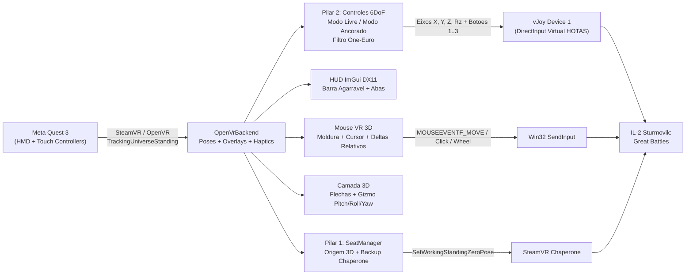

# IL-2 VR QoL Companion (`v0.8.0`)


[](LICENSE)


**Companion app externo de Qualidade de Vida, Controles Virtuais 6DoF (estilo VTOL VR), Posicionamento de Cockpit e Mouse VR para *IL-2 Sturmovik: Great Battles* (Meta Quest 3 / SteamVR).**

*External VR Quality of Life, 6DoF Virtual Flight Controls (VTOL-VR style), Cockpit Seat Positioning, and VR Menu Raycaster Mouse companion for IL-2 Sturmovik: Great Battles (Meta Quest 3 / SteamVR).*

> [!IMPORTANT]
> **100% Externo / Zero alteração em arquivos do jogo:** O companion roda como um aplicativo separado usando **OpenVR Overlays**, **vJoy** (joystick virtual) e **Win32 `SendInput`**. Nenhum binário ou pacote `.gtp` do IL-2 é modificado, preservando compatibilidade total com atualizações e servidores multiplayer com verificação de integridade.

---

## Sumário / Contents

- [Arquitetura Geral / How It Works](#arquitetura-geral--how-it-works)
- [Guia Completo em Português (BR)](#-guia-completo-português-br)
  - [1. Requisitos e Início Rápido](#1-requisitos-e-início-rápido)
  - [2. Mapa de Controles VR (Quest 3) e Atalhos Globais](#2-mapa-de-controles-vr-quest-3-e-atalhos-globais)
  - [3. Como Cada Módulo Funciona & Como Interagir](#3-como-cada-módulo-funciona--como-interagir)
    - [Pilar 1 — Posicionamento do Assento & Origem VR 3D](#pilar-1--posicionamento-do-assento--origem-vr-3d)
    - [HUD VR Flutuante & Barra Agarrável Estilo Quest 3](#hud-vr-flutuante--barra-agarrável-estilo-quest-3)
    - [Pilar 2 — Manche & Manete Virtuais 6DoF (Modo Livre vs. Modo Ancorado)](#pilar-2--manche--manete-virtuais-6dof-modo-livre-vs-modo-ancorado)
    - [Auto-Bind IL-2 & Sincronização Automática com vJoy](#auto-bind-il-2--sincronização-automática-com-vjoy)
    - [Camada Visual 3D — Flechas & Gizmo de Rotação das Mãos](#camada-visual-3d--flechas--gizmo-de-rotação-das-mãos)
    - [Mouse VR nos Menus do IL-2 (Raycaster 3D)](#mouse-vr-nos-menus-do-il-2-raycaster-3d)
    - [Idiomas (`i18n` — `pt-BR` & `en-US`)](#idiomas-i18n--pt-br--en-us)
- [Complete Guide in English (US)](#-complete-guide-english-us)
- [Compilação e Testes / Build & Tests](#compilação-e-testes--build--tests)
- [Estrutura do Repositório](#estrutura-do-repositório)

---

## Arquitetura Geral / How It Works



---

## 🇧🇷 Guia Completo (Português BR)

### 1. Requisitos e Início Rápido

#### Pré-requisitos
1. **Windows 10/11 (64 bits)**.
2. ***IL-2 Sturmovik: Great Battles*** configurado para rodar em VR via **SteamVR / OpenVR** (Quest Link, Air Link, Virtual Desktop ou Steam Link).
3. **[vJoy](https://github.com/BrunnerInnovation/vJoy)** instalado com **Device 1** habilitado (eixos `X`, `Y`, `Z`, `Rz` + botões).
4. Caso o seu vJoy esteja só com alguns eixos ativos, execute **[reparar_vjoy_eixos.bat](reparar_vjoy_eixos.bat)** como Administrador uma única vez (ou clique no botão vermelho `ATIVAR EIXOS Y/Z/Rz NO VJOY (Admin)` dentro do HUD).

#### Como rodar
1. Dê um **duplo clique em [iniciar_mod_il2_vr.bat](iniciar_mod_il2_vr.bat)** pelo Windows Explorer (isso garante execução no desktop padrão do Windows, permitindo que o Mouse VR envie eventos `SendInput` para o jogo).
2. Abra o **SteamVR** e o **IL-2 Sturmovik**.
3. O companion detecta automaticamente o `SteamVR` e o processo `Il-2.exe`:
   - Adquire o **vJoy Device 1** (e recupera automaticamente caso outro programa/estado o solte).
   - Detecta a pasta `data/input` do IL-2, identifica o índice real do vJoy (`joy0`, `joy1`, etc.) em `devices.txt` e sincroniza os perfis de eixos/botões (`global.actions` / perfis customizados) sempre que necessário.
4. Ao fechar o companion, ele **restaura automaticamente** a origem original do Chaperone do SteamVR.

---

### 2. Mapa de Controles VR (Quest 3) e Atalhos Globais

| Controle no Quest 3 | Ação | Onde / Quando |
|---|---|---|
| **`3x L3`** *(clique triplo analógico Esq)* | **Abrir / Fechar** o painel HUD em VR | Em qualquer momento |
| **`3x R3`** *(clique triplo analógico Dir)* | Alternar **Modo Voo 6DoF ↔ Ajustar Origem 3D** | Em qualquer momento |
| **`Botão Y`** *(controle Esquerdo)* | **Recentralizar Origem VR** exatamente na pose atual da cabeça | Em qualquer momento |
| **`Botão X`** *(controle Esquerdo)* | **Ativar / Desativar Mouse VR** nos menus do jogo | Menus / Cockpit *(fora do HUD)* |
| **Gatilho / A / X** apontando no HUD | Clicar botões, marcar caixas e arrastar sliders do painel | Com o HUD visível |
| **Gatilho / Grip** na **barra inferior do HUD** | **Agarrar e reposicionar o HUD** no espaço 3D *(Analógico Y aproxima/afasta)* | Com o HUD visível |
| **`Grip Direito`** *(Modo Voo)* | Segurar/operar o **Manche Virtual 6DoF** *(soltar volta ao centro)* | Em voo |
| **`Grip Esquerdo`** *(Modo Voo)* | Segurar/mover a **Manete de Potência** *(soltar trava na posição atual)* | Em voo |
| **`Gatilho Direito / A Direito`** *(Em voo)* | Botões **vJoy 1 e 2** *(Metralhadoras / Canhões / Armas)* | Em voo *(sem apontar no HUD)* |
| **`Gatilho Esquerdo`** *(Em voo)* | Botão **vJoy 3** *(Freios / auxiliar)* | Em voo *(sem apontar no HUD)* |
| **`Grip Dir / Esq`** *(Modo Editar Origem)* | **Arrastar a origem 3D do cockpit** no espaço *(apenas X/Y/Z, sem girar yaw)* | Modo Origem (`3x R3`) |
| **`Grip Dir / Esq`** *(Modo Mouse VR)* | **Reposicionar a moldura da tela do Mouse VR** sobre o menu *(Analógico Y = distância, X = largura)* | Com Mouse VR ativo |
| **`Gatilho` / `Botão A (Dir)` / `Analógico Y`** *(Modo Mouse VR)* | **Clique Esquerdo** / **Clique Direito** / **Scroll** no menu do IL-2 | Com Mouse VR ativo |

<details>
<summary>⌨️ Atalhos Globais de Teclado no Windows (funcionam mesmo com o IL-2 em foco)</summary>

| Tecla | Função |
|---|---|
| `Ctrl + Alt + O` / `M` / `F1` | Mostrar / Ocultar HUD VR |
| `Ctrl + Alt + R` / `Home` / `NumPad 5` | Recentralizar origem VR na cabeça |
| `Ctrl + Alt + 0` / `Backspace` / `NumPad 0` | Zerar offsets manuais |
| `Ctrl + Alt + T` | Teste visual rápido (`+25 cm` de altura) |
| `Ctrl + Alt + W / S / A / D` *(ou setas / NumPad)* | Mover cockpit Cima/Baixo/Esq/Dir (passo normal) |
| `Ctrl + Alt + I / K` *(ou PageUp / PageDown)* | Mover cockpit Frente/Trás (passo normal) |
| `Ctrl + Alt + Q / E` *(ou `<` / `>`)* | Girar Yaw Esquerda / Direita |
| Adicionar **`Shift`** (`Ctrl + Alt + Shift + ...`) | Mesmo movimento em **Passo Fino (`2 mm / 0.5°`)** |

</details>

---

### 3. Como Cada Módulo Funciona & Como Interagir

#### Pilar 1 — Posicionamento do Assento & Origem VR 3D
*Arquivos principais: [`SeatManager.h`](src/seat/SeatManager.h), [`SeatManager.cpp`](src/seat/SeatManager.cpp), [`OpenVrBackend.cpp`](src/vr/OpenVrBackend.cpp)*

- **Por que existe:** No Quest 3 via OpenVR, o IL-2 executa no universo `TrackingUniverseStanding`. Alterar diretamente o `SeatedZeroPose` mistura sistemas de coordenadas e causa saltos de `~180°`. O `SeatManager` lê e grava exclusivamente a matriz `WorkingStandingZeroPose`, faz backup da original na primeira conexão e aplica todos os deslocamentos relativos ao vetor horizontal para onde o piloto está olhando (`Yaw`).
- **Como interagir:**
  1. Sente-se confortável e aperte **`Y` (controle esquerdo)** para alinhar o assento do cockpit à sua cabeça instantaneamente.
  2. Se quiser se aproximar do painel de instrumentos, subir o banco para enxergar sobre o nariz do avião ou ajustar lateralmente no cockpit: dê um **clique triplo no analógico direito (`3x R3`)** — você sentirá um pulso háptico confirmando a troca para **`MODO: AJUSTAR ORIGEM 3D`**.
  3. Segure qualquer **`Grip`** no ar e mova a mão como se estivesse puxando o avião ao seu redor (a rotação `Yaw` fica travada para nunca entortar o horizonte por acidente).
  4. Dê outro **`3x R3`** para travar a posição e voltar ao voo.
  5. Ajustes milimétricos também estão disponíveis no Pilar 1 pelos botões de direção (com opção **Passo Fino `2 mm / 0.5°`**).

---

#### HUD VR Flutuante & Barra Agarrável Estilo Quest 3
*Arquivos principais: [`main.cpp`](src/app/main.cpp), [`MathTypes.cpp`](src/core/MathTypes.cpp)*

- O painel de controle roda simultaneamente na **janela desktop do Windows** e como **overlay D3D11 dentro do SteamVR** (`0.62 m` de largura por padrão), com raycaster ativo automaticamente para qualquer das duas mãos que apontar para o painel (`tryHand`).
- **Como interagir:**
  - Use **`3x L3`** para abrir ou esconder o HUD em voo sem ocupar botões de combate.
  - **Barra Agarrável Inferior:** Na base da janela existe uma barra azul (`=== SEGURE AQUI (Gatilho/Grip + Analogico Dist.) PARA MOVER PAINEL ===`). Aponte o laser nela, segure **`Gatilho`** ou **`Grip`** e mova o painel para o console lateral ou canto superior do seu campo de visão. Empurre/puxe o **analógico vertical (`Y`)** enquanto segura para ajustar a distância entre **`0.35 m` e `1.60 m`**. Ao soltar, o HUD fica ancorado exatamente onde você o deixou.
  - Clique em **`Painel na Frente`** no Pilar 1 a qualquer momento para trazê-lo de volta para a sua frente.

---

#### Pilar 2 — Manche & Manete Virtuais 6DoF (`Modo Livre` vs. `Modo Ancorado`)
*Arquivos principais: [`MathTypes.h`](src/core/MathTypes.h), [`MathTypes.cpp`](src/core/MathTypes.cpp), [`main.cpp`](src/app/main.cpp)*

Os movimentos 6DoF das mãos são projetados no referencial horizontal do piloto, suavizados por **filtros adaptativos One-Euro** (`stickFilterX`, `stickFilterY`, `rudderFilterRz` — zero latência em curvas rápidas e sem tremor parado), com zona morta (`deadzone`) e curva exponencial (`expo`) configuráveis antes de alimentar o **vJoy**.

Você pode escolher **2 modos de operação** no Pilar 2:

1. **`Modo Livre`** *(padrão estilo VTOL VR)*:
   - Segure **`Grip Direito`** em qualquer posição confortável (no apoio de braço da cadeira, na perna ou no ar): o ponto e ângulo onde você fecha o Grip vira o centro neutro (`0, 0`). Mover/inclinar o punho comanda **Roll (`X`)** e **Pitch (`Y`)**, e torcer o pulso comanda o **Leme (`Rz`)** *(ativável via checkbox)*. Ao soltar, retorna ao centro.
   - Segure **`Grip Esquerdo`** em qualquer lugar para empurrar/puxar a **Manete (`Z`)**. Ao soltar o Grip esquerdo, a potência **permanece travada** na porcentagem escolhida, com cliques hápticos sutis nos detentes de `0%`, `50%` e `100%`.
   - Mesmo sem segurar o Grip, os analógicos físicos funcionam para **ajuste fino / trim** (`Stick Dir` = manche, `Stick Esq X` = leme, `Stick Esq Y` = ajuste fino da potência).

2. **`Modo Ancorado`** *(Controles Virtuais Fixos no Cockpit)*:
   - Cria **1 Manche Virtual** e **1 Manete Virtual** fixos em coordenadas 3D reais dentro do seu cockpit.
   - **Proximidade tátil:** Ao aproximar a mão a menos de **`14 cm`** de uma âncora fixa, o controle vibra suavemente informando que sua mão alcançou o manche ou a manete.
   - **Submodo `Posicionar Controles`:** Clique no botão **`Posicionar Controles`** no Pilar 2 para calibrar o seu cockpit:
     1. Os eixos do `vJoy` vão imediatamente para **neutro (`X=0, Y=0, Z=50%, Rz=0`)** para não derrubar o avião durante o ajuste.
     2. Os marcadores 3D das âncoras aparecem no espaço.
     3. Segure **`Grip Direito`** para arrastar e girar a âncora do Manche exatamente para cima do manche 3D do avião; segure **`Grip Esquerdo`** para alinhar a Manete à alavanca real do cockpit.
     4. Clique em **`Salvar Ancoras & Voltar ao Voo`** — as posições e orientações completas (matriz 3x4) são salvas automaticamente em `config/controls.anchors.json`.

---

#### Auto-Bind IL-2 & Sincronização Automática com vJoy
*Arquivos principais: [`VJoyClient.cpp`](src/output/VJoyClient.cpp), [`main.cpp`](src/app/main.cpp)*

- **Por que existe:** O assistente de configuração de eixos (*Key Mapping*) do IL-2 pede para levar o eixo ao centro, máximo e mínimo sem interferência cruzada. Tentar fazer isso no ar segurando um controle 6DoF pode misturar Pitch e Roll durante a leitura.
- **Como usar:**
  1. No menu *Settings -> Key Mapping* do IL-2, clique no comando desejado (`Pitch`, `Roll`, `Yaw` ou `Throttle`).
  2. No HUD do mod (Pilar 2), clique no botão correspondente em **Auto-Bind IL-2** (`Bind Roll X`, `Bind Pitch Y`, `Bind Manete Z` ou `Bind Leme Rz`).
  3. O companion executa uma varredura limpa de **4.2 segundos** em um único eixo isolado (`Centro -> +100% -> -100% -> Centro`), permitindo que o IL-2 reconheça instantaneamente 100% dos eixos.
  4. Use **`Sincronizar IL-2`** (também executado automaticamente ao iniciar/fechar o jogo) para atualizar os prefixos `joyN` em `data/input/` se outros joysticks físicos mudarem a numeração do Windows.

---

#### Camada Visual 3D — Flechas & Gizmo de Rotação das Mãos
*Arquivos principais: [`OpenVrBackend.cpp`](src/vr/OpenVrBackend.cpp), [`MathTypes.cpp`](src/core/MathTypes.cpp)*

- Na aba **`Gizmo 3D & Mouse`** (canto inferior direito do HUD):
  - **`Mostrar Flechas & Gizmo de Rotacao das Maos (3D)`:** Liga overlays 3D acoplados diretamente aos controladores esquerdo e direito mostrando **Frente (`-Z` ciano)**, **Direita (`+X` vermelho/dourado)** e anel de referência no espaço.
  - **`Mostrar Marcadores Ancorados no Cockpit`:** Mantém visível a posição espacial salva do Manche e da Manete quando estiver voando em `Modo Ancorado`.
  - **Leitura Numérica de Ângulos:** Exibe em tempo real `Pitch`, `Roll` e `Yaw` em graus (`extractEulerAnglesDeg`) de cada mão para verificar torções de pulso e calibração.

---

#### Mouse VR nos Menus do IL-2 (Raycaster 3D)
*Arquivos principais: [`KeyboardInjector.cpp`](src/output/KeyboardInjector.cpp), [`OpenVrBackend.cpp`](src/vr/OpenVrBackend.cpp), [`main.cpp`](src/app/main.cpp)*

- **Como funciona:** Como o IL-2 utiliza leitura de mouse via DirectInput (`exclusive = 1` no `startup.cfg`), um cursor puramente absoluto sofre saltos para as bordas. O companion projeta o raio do controlador sobre uma **moldura virtual 16:9** em 3D (`yaw = 0°` paralelo à interface do jogo, distância padrão `0.85 m`, largura `1.30 m`), corta visualmente o feixe laser na superfície da tela, renderiza um **cursor 3D de interseção** sobre a moldura e traduz os movimentos em **deltas relativos puros** (`MOUSEEVENTF_MOVE`) filtrados por One-Euro com limite anti-pico (`±120 px/frame`).
- **Como interagir:**
  1. Aperte **`Botão X` (controle esquerdo)** *(ou o botão azul `ATIVAR MOUSE VR NOS MENUS DO JOGO` no Pilar 1)*. O HUD centralizado oculta-se automaticamente para não tampar os menus do IL-2.
  2. Se a moldura ciana não estiver exatamente sobre a tela de menu do jogo, **segure `Grip`** *(Esquerdo ou Direito)* para arrastá-la livremente até encaixar sobre o menu *(mantendo `yaw = 0°` reto)*. Use **`Analógico Y`** para aproximar/afastar (`0.35 m` a `2.20 m`) e **`Analógico X`** para ajustar a largura (`0.50 m` a `2.60 m`). Ao soltar, a posição fica salva em `config/settings.json`.
  3. Aponte o laser (o cursor 3D acompanha sua mira) e use:
     - **`Gatilho` (Dir ou Esq):** Clique esquerdo.
     - **`Botão A` (Dir):** Clique direito.
     - **`Analógico Y`:** Scroll vertical.
  4. Enquanto o Mouse VR estiver ativo, os botões de armamento no `vJoy` ficam bloqueados por segurança. Ao entrar na cabine, aperte **`X` (Esquerdo)** novamente para voltar aos botões de tiro/voo.

---

#### Idiomas (`i18n` — `pt-BR` & `en-US`)
*Arquivos principais: [`LocaleManager.h`](src/core/LocaleManager.h), [`LocaleManager.cpp`](src/core/LocaleManager.cpp), [`config/locales/`](config/locales/)*

- Toda a interface do HUD é carregada dinamicamente de arquivos JSON em [`config/locales/`](config/locales/) (`pt-BR.json` e `en-US.json` inclusos).
- Na aba **`Idiomas / Languages`**, troque o idioma com 1 clique via laser ou mouse; a escolha é salva em `config/settings.json`.
- **Contribuindo com novas traduções:** Basta copiar [`config/locales/en-US.json`](config/locales/en-US.json) para `config/locales/<codigo>.json` (ex.: `es-ES.json`, `de-DE.json`, `ru-RU.json`), atualizar `"meta": { "code", "name" }` e traduzir `"strings"`. O app descobre automaticamente sem recompilar.

---

## 🇺🇸 Complete Guide (English US)

### Quick Start
1. Ensure **[vJoy](https://github.com/BrunnerInnovation/vJoy)** Device 1 has axes `X, Y, Z, Rz` + buttons enabled (run [`reparar_vjoy_eixos.bat`](reparar_vjoy_eixos.bat) as Administrator once if needed).
2. Double-click [`iniciar_mod_il2_vr.bat`](iniciar_mod_il2_vr.bat) from Windows Explorer *(must run on the normal desktop session so Win32 `SendInput` has access to inject menu mouse input)*.
3. Start **SteamVR** and ***IL-2 Sturmovik: Great Battles*** — the companion connects automatically, acquires vJoy Device 1, syncs `devices.txt` (`joyN`) bindings cleanly, and restores your SteamVR Chaperone on exit.

### Quest 3 Controls Summary

| Input | Action |
|---|---|
| **`3x L3`** *(Left Stick Triple-Click)* or `Ctrl+Alt+O` | Open / Close the VR HUD Overlay |
| **`3x R3`** *(Right Stick Triple-Click)* | Toggle **6DoF Flight Mode** ↔ **Edit 3D VR Origin** |
| **`Y` Button** *(Left Controller)* | Instant Head-Pose Origin Recenter (`TrackingUniverseStanding`) |
| **`X` Button** *(Left Controller)* | Toggle **VR Raycaster Mouse** in IL-2 Menus *(auto-hides centered HUD)* |
| **Hold HUD Bottom Grab Bar** *(Trigger or Grip)* | Move HUD anywhere in 3D space (+ **Stick Y** depth `0.35 m - 1.60 m`) |
| **Hold Right Grip** *(Flight)* | Operate 6DoF Virtual Stick (`Roll X`, `Pitch Y`, optional `Wrist-Twist Rudder Rz`) |
| **Hold Left Grip** *(Flight)* | Move Virtual Throttle Lever (`Z` — latches with haptic detents at `0%, 50%, 100%`) |
| **Hold Grip** *(VR Mouse Mode)* | Drag & align the 3D Virtual Mouse Screen onto IL-2's UI (+ **Stick Y** dist, **Stick X** size) |
| **Trigger / Right `A` / Stick `Y`** *(VR Mouse Mode)* | Left Click / Right Click / Vertical Scroll *(vJoy fire buttons locked for safety)* |

### Module Architecture Overview
- **VR Origin & Seat Positioning (`Pillar 1`):** Uses SteamVR's `TrackingUniverseStanding` exclusively so Meta Quest 3 poses, OpenVR overlays, and IL-2's cockpit share one coordinate space without `180°` yaw flips. Supports instant head recentering, 3D grip world-translation (`Yaw` locked), coarse/fine nudges (`2 mm / 0.5°`), and `+25 cm` diagnostic test.
- **6DoF Virtual Stick & Throttle (`Pillar 2`):** Uses horizontal pilot-frame projections + One-Euro adaptive filtering + deadzone/expo shaping. Choose **`Free Mode`** (center resets wherever you close Grip) or **`Anchored Mode`** (fixed 3D cockpit stick/throttle anchors with `14 cm` proximity haptic cues and **`Position Controls`** calibration submode that neutralizes flight axes while positioning anchors in `config/controls.anchors.json`). Includes single-axis **Auto-Bind** calibration sweeps (`4.2 s`) so IL-2's key-mapping wizard detects each axis cleanly without 6DoF crosstalk.
- **3D Hand Gizmo & Euler Readout:** Toggleable OpenVR orientation arrow overlays (`Forward -Z`, `Right +X`) for both controllers and anchored cockpit controls, paired with live `Pitch / Roll / Yaw` degree readouts.
- **DirectInput-Safe VR Menu Mouse:** Renders a `16:9` cyan 3D frame + glowing 3D ray-intersection cursor dot clipped to the screen plane, feeding smoothed pure relative `MOUSEEVENTF_MOVE` deltas so IL-2's exclusive DirectInput menu cursor tracks smoothly without edge runaway.

---

## Compilação e Testes / Build & Tests

Requisitos de desenvolvimento: **Visual Studio 2022+** (MSVC, C++20), **CMake**, **vcpkg** (`nlohmann-json`, `spdlog`, `glm`, `imgui`, `catch2`, `openvr`).

```powershell
powershell -ExecutionPolicy Bypass -File .\tools\build_and_test.ps1
```

Executar apenas os testes unitários:

```powershell
ctest --test-dir build/windows-msvc-debug --output-on-failure
.\build\windows-msvc-debug\il2vr_tests.exe
```

---

## Estrutura do Repositório

```text
il2_vr_qol/
├── src/
│   ├── app/main.cpp              # Loop principal DX11 + ImGui, hotkeys, raycaster, Mouse VR e sync IL-2
│   ├── core/MathTypes.*          # Álgebra 3D, filtros One-Euro, TripleClickDetector, Euler, interseção 3D
│   ├── core/LocaleManager.*      # Motor de tradução i18n JSON em tempo real
│   ├── vr/OpenVrBackend.*        # OpenVR (TrackingUniverseStanding, overlays HUD/Laser/Gizmos/Mouse Screen)
│   ├── seat/SeatManager.*        # Backups do Chaperone, recenter e deslocamento em espaço do piloto
│   ├── output/VJoyClient.*       # Interface vJoy DLL + auto-reconfiguração Admin dos 8 eixos
│   ├── output/KeyboardInjector.* # SendInput (teclas para NumPad 5 + deltas relativos/cliques/scroll de mouse)
│   └── telemetry/Telemetry*.*    # Listener UDP para telemetria do jogo
├── config/
│   ├── locales/                  # Traduções modulares (pt-BR.json, en-US.json)
│   └── examples/                 # Exemplos de perfis, atalhos e hotspots
├── tests/test_main.cpp           # Suíte Catch2 (matemática 6DoF, triple-click, i18n 100% parity)
├── spikes/                       # Protótipos isolados (OpenVR pose/input, vJoy, UDP, KeyboardInjector)
├── tools/build_and_test.ps1      # Script completo configure + build + CTest + smoke tests
├── iniciar_mod_il2_vr.bat        # Launcher rápido no Windows
└── reparar_vjoy_eixos.bat        # Configurador rápido vJoy Device 1 (Admin)
```

---

## Licença & Incorporação Comercial / License & Commercial Integration

**Copyright © 2026 João Tarran (Tarranzilla) — `joaotarran@gmail.com`**

Este projeto adota **Licenciamento Duplo (*Dual Licensing*)**:

- **Comunidade / Open Source — GNU GPLv3 ([LICENSE](LICENSE)):** Gratuito para jogadores, pesquisadores e contribuidores de código aberto. Qualquer redistribuição ou projeto derivado sob a GPLv3 deve manter o código-fonte aberto sob a mesma licença (**copyleft forte**), incluindo isenção completa de garantias e responsabilidade (Seções 15 e 16 da GPLv3).
- **Licença Comercial / Proprietária ([COMMERCIAL_LICENSE.md](COMMERCIAL_LICENSE.md)):** Estúdios de jogos, distribuidoras ou fabricantes interessados em **integrar qualquer parte deste código em produtos fechados/comerciais** *(como integração oficial em simuladores proprietários)* sem abrir o código-fonte sob a GPLv3 precisam adquirir uma **licença comercial** com o autor (`joaotarran@gmail.com`).
- **Contribuições & CLA ([CONTRIBUTING.md](CONTRIBUTING.md)):** Pull requests são muito bem-vindos! Ao contribuir, você mantém seus direitos autorais e autoriza a inclusão tanto na edição **GPLv3** quanto em contratos comerciais do projeto.

> *Dual-licensed under **GNU GPLv3** ([LICENSE](LICENSE)) for open-source community use and a separate **Commercial License** ([COMMERCIAL_LICENSE.md](COMMERCIAL_LICENSE.md)) for proprietary/studio integration. Contact: **João Tarran (Tarranzilla)** — `joaotarran@gmail.com`.*
