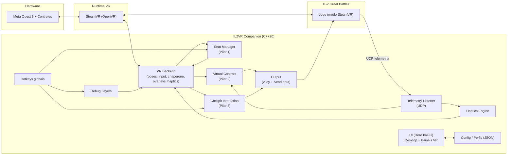
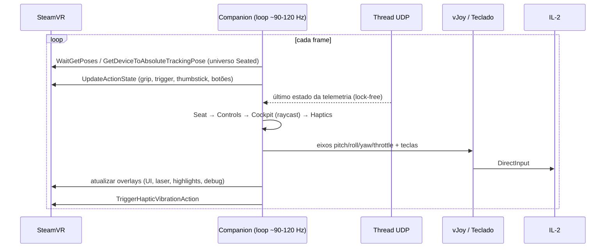
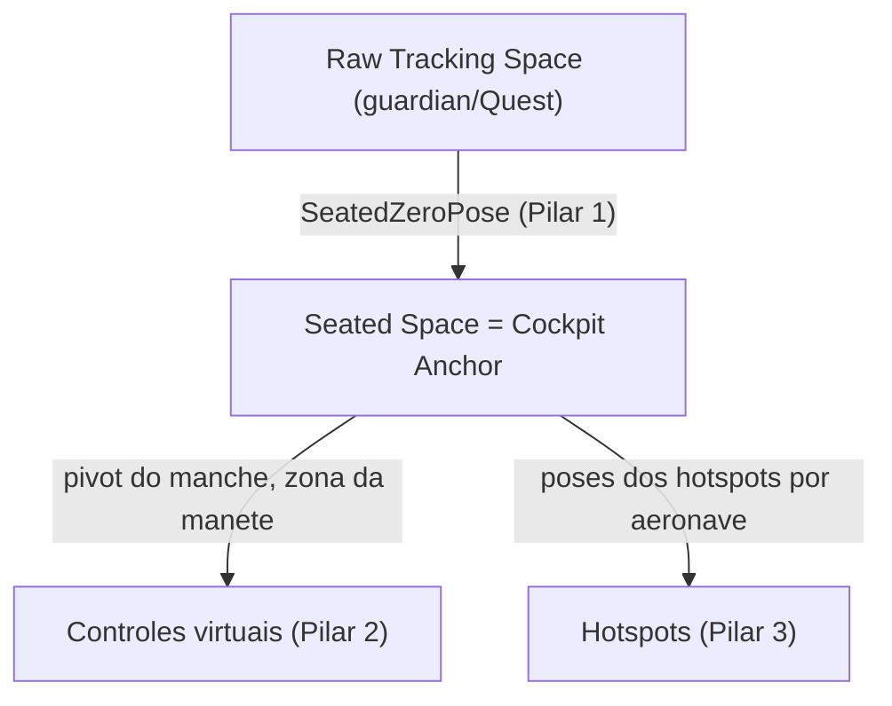

# 02 – Arquitetura

## Visão geral

Um único processo nativo (**IL2VR Companion**) roda ao lado do jogo. Ele se registra no SteamVR como *aplicação de overlay*, o que permite: (a) ler poses e botões dos controles mesmo com o jogo em foco, (b) alterar o "zero" do espaço sentado (pilar 1), (c) desenhar painéis 2D, lasers e destaques dentro do VR. A saída para o jogo é feita apenas por **dispositivos de entrada padrão**: joystick virtual (vJoy) e teclado (`SendInput`).



## Módulos

| Módulo | Responsabilidade | Dependências |
|--------|------------------|--------------|
| `core` | Loop principal, relógio, event bus, logging (spdlog), math (glm) | – |
| `vr` | Interface `IVrBackend` + implementação `OpenVrBackend`: poses, input (IVRInput com action manifest), chaperone, overlays, haptics, render models | OpenVR SDK |
| `seat` | Offset do assento, recenter, nudge grosso/fino, "arrastar o mundo", perfis | `vr`, `config` |
| `controls` | Manche/manete virtuais: grab, pivot, curvas, deadzone, trim, mapeamento para eixos/botões | `vr`, `output` |
| `cockpit` | Raycaster, hotspots, editor/calibração, ações (tecla, hold, toggle, eixo arrastável) | `vr`, `output`, `config` |
| `telemetry` | Listener UDP, parser dos pacotes do IL-2, estado do avião (RPM, eventos, acelerações) | – |
| `haptics` | Converte eventos/estado em padrões de vibração (pulsos, ruído, detentes) | `vr`, `telemetry` |
| `output` | `VJoyDevice` (eixos/botões) e `KeyboardInjector` (scancodes, press/hold/release) | vJoy SDK, Win32 |
| `ui` | Janela desktop (D3D11 + ImGui) e painéis VR (ImGui renderizado em textura → overlay) | `vr`, D3D11 |
| `layers` | Registro de camadas de debug, cada uma com `enabled`, atalho e renderização própria | `ui`, `vr` |
| `config` | Carregar/salvar JSON com schema versionado, hot-reload, perfis por aeronave | nlohmann-json |
| `hotkeys` | Atalhos globais (RegisterHotKey / Raw Input), funcionam com o jogo em foco | Win32 |

## Loop de execução



- **Thread principal:** VR + lógica + saída (determinístico e de baixa latência).
- **Thread de telemetria:** recebe UDP e publica um snapshot atômico/double-buffer.
- **Thread de UI desktop:** opcional; na v1 a UI pode rodar no mesmo loop (ImGui é barato).

## Sistemas de coordenadas

Toda a lógica opera no **universo Seated** do OpenVR. O pilar 1 altera o *seated zero pose*; por isso, controles virtuais (pilar 2) e hotspots (pilar 3) definidos nesse espaço **acompanham automaticamente** o alinhamento do usuário. Este é o principal acoplamento entre os pilares:



> [!WARNING]
> Se o usuário usar o "Reset VR view" **do próprio jogo**, a câmera do jogo pode se deslocar em relação ao espaço Seated, desalinhando hotspots. A recomendação é recentralizar sempre pelo Companion (ver Spike S2/S7).

## Stack

| Item | Escolha | Motivo |
|------|---------|--------|
| Linguagem | C++20 | OpenVR, vJoy e Win32 são nativos; baixa latência; possibilidade futura de OpenXR API layer (que exige DLL nativa) |
| Build | CMake + vcpkg (manifest) | Padrão, integra com Visual Studio |
| UI | Dear ImGui (+ backend D3D11) | Mesmo código para janela desktop e painéis VR; ótimo para camadas de debug |
| VR | OpenVR SDK | Overlays, chaperone e input para apps em segundo plano |
| JSON | nlohmann-json | Simples, header-only |
| Log | spdlog | Rápido, arquivo + console |
| Math | glm | Quaternions/matrizes |
| Joystick virtual | vJoy (fork BrunnerInnovation) | Reconhecido como DirectInput pelo IL-2 |
| Testes | Catch2 | Testes unitários de math, curvas, raycast, parsers |

Ver [ADR-0003](adr/0003-stack-cpp-imgui.md).

## Configuração e perfis

```
%APPDATA%\IL2VR\
├── settings.json          # globais: backend, atalhos, camadas, telemetria
├── seat\
│   ├── default.json       # offset padrão
│   └── <aeronave>.json    # offsets por aeronave (opcional)
├── controls\
│   └── default.json       # pivot, curvas, deadzones, mapeamento vJoy
└── cockpits\
    └── <aeronave>.json    # hotspots e ações
```

Formatos de referência em [config/examples](../config/examples/). Todos os arquivos possuem `"schemaVersion"` para migrações.

## Integração com o IL-2

| Canal | Direção | Uso |
|-------|---------|-----|
| vJoy (DirectInput) | App → Jogo | Eixos: pitch, roll, yaw, throttle, + eixos de alavancas (mistura, passo, radiador...) e botões (gatilhos) |
| `SendInput` (scancode) | App → Jogo | Ações discretas do cockpit (trem, flaps, magnetos, luzes...) |
| UDP `motiondevice` | Jogo → App | Orientação/acelerações → buffet, G, vibração |
| UDP `telemetrydevice` | Jogo → App | RPM, eventos (tiro, impacto, trem, etc.) → háptica e auto-detecção |

O usuário configura os binds no jogo uma vez (ou importa um preset fornecido pelo projeto).

## Evolução futura: backend OpenXR

A interface `IVrBackend` isola o runtime. Uma segunda implementação poderia ser um **OpenXR API Layer** (DLL carregada no processo do jogo, no estilo OpenXR Toolkit / OpenKneeboard), útil se o jogo for executado via OpenXR (nativo ou OpenComposite). O layer conversaria com o Companion via memória compartilhada. Não faz parte da v1 – ver [ADR-0002](adr/0002-backend-vr-openvr-primeiro.md).
