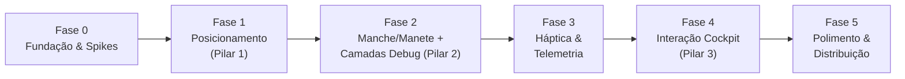

# 03 – Roadmap e Backlog

| Fase | Marco | Critério de saída |
|------|-------|-------------------|
| 0 | **M0 – Viabilidade** | Todos os spikes críticos (S1–S6) com resultado documentado |
| 1 | **M1 – Assento** | Recentralizar e ajustar posição/yaw dentro do IL-2 via UI e teclado, com perfil salvo |
| 2 | **M2 – Voar com as mãos** | Decolar, voar e pousar usando só os controles do Quest 3 |
| 3 | **M3 – Sentir** | Vibração em tiro, impacto, RPM do motor e detentes da manete |
| 4 | **M4 – Tocar o painel** | ≥ 10 controles acionáveis por raycast em 1 aeronave de referência |
| 5 | **M5 – Release 0.1** | Instalador, preset de binds, documentação de usuário |

---

## Fase 0 – Fundação & Spikes

**Repositório e build**
- [x] `git init`, `.gitignore`, `.editorconfig`, licença
- [x] CMake + vcpkg manifest (`openvr`, `imgui[dx11-binding,win32-binding]`, `nlohmann-json`, `spdlog`, `glm`, `catch2`)
- [x] Integrar SDK do vJoy (`vJoyInterface.dll` carregado dinamicamente)
- [x] Esqueleto do app: loop principal, logging, janela ImGui desktop
- [x] CI local: build + testes (script PowerShell) — `.\tools\build_and_test.ps1` validado (CTest + self-tests S2/S4/S5/S6 + smoke-test)

**Spikes** (detalhes em [04-riscos-e-spikes.md](04-riscos-e-spikes.md))
- [x] S1 – Caminho de runtime: IL-2 + Quest 3 em SteamVR (`vrserver`, `vrmonitor` e `Il-2.exe` ativos simultaneamente; app conectando em `overlay=sim`)
- [ ] S2 – Alterar *seated zero pose* com o IL-2 rodando
- [ ] S3 – Ler input dos controles com o jogo em foco
- [ ] S4 – vJoy reconhecido e mapeável no IL-2
- [ ] S5 – Capturar e decodificar telemetria UDP
- [ ] S6 – `SendInput` com scancodes aceito pelo IL-2
- [ ] S7 – Interação entre recenter do jogo e espaço Seated
- [ ] S8 – Overlays visíveis por cima do jogo (latência, legibilidade)

## Fase 1 – Posicionamento do Headset (Pilar 1)
- [ ] `IVrBackend::getSeatedZero/setSeatedZero` + commit Live
- [ ] Backup do chaperone original e restauração ao sair/crash
- [ ] Recenter "em um clique" (pose atual da cabeça → assento, só yaw)
- [ ] Nudge X/Y/Z/Yaw com passo grosso e fino
- [ ] Atalhos globais configuráveis
- [ ] Painel desktop "Assento" (sliders + botões + valores numéricos)
- [ ] Painel VR + toast de feedback ("Altura +5 mm")
- [ ] Arrastar o mundo com os dois grips (modo opcional)
- [ ] Perfis: default + por aeronave, auto-aplicar ao trocar de perfil
- [ ] Testes unitários de composição de transformações

## Fase 2 – Manche e Manete Virtuais (Pilar 2)
- [ ] Action manifest OpenVR (grip, trigger, A/B/X/Y, thumbsticks, poses aim/grip)
- [ ] `VJoyDevice`: eixos X/Y/Z/Rx/Ry/Rz/Sl0/Sl1 + 32 botões
- [ ] Manche: grab por proximidade, pivot configurável, modos *deslocamento* e *rotação*
- [ ] Manete: grab, eixo linear, retenção ao soltar, modo thumbstick incremental
- [ ] Leme: thumbstick X ou torção do pulso (configurável)
- [ ] Curvas de resposta, deadzone, saturação, inversão, suavização (filtro One-Euro)
- [ ] Trim por thumbstick
- [ ] Gatilhos/botões → botões vJoy (armas, freios...)
- [ ] Wizard de calibração (posicionar pivot e zona da manete com a mão)
- [ ] **Camadas de debug**: monitor de eixos, estado do input bruto, gizmo do pivot/zonas, log de eventos, painel de perf (frame time)
- [ ] Gerenciador de camadas (UI + atalhos + persistência)
- [ ] Preset de binds do IL-2 para o dispositivo vJoy

## Fase 3 – Háptica & Telemetria
- [ ] Listener UDP + parser (`motiondevice`, `telemetrydevice`)
- [ ] Camada debug "Telemetria" (valores ao vivo + gráfico)
- [ ] Motor de háptica: pulso, trem de pulsos, ruído contínuo, prioridade/mixagem
- [ ] Mapeamentos: tiro, impacto recebido, RPM, toque no solo, buffet (acelerações), detentes da manete (limites / WEP)
- [ ] Ganho por canal e por mão na UI
- [ ] Ferramenta `tools/` de gravação/replay de telemetria para testes offline

## Fase 4 – Interação com o Cockpit (Pilar 3)
- [ ] Modelo de hotspot (forma, pose, ação) + loader de perfil de cockpit
- [ ] Raycaster (raio × caixa/esfera/retângulo) com prioridade e histerese
- [ ] Visual: laser, retícula no ponto de impacto, highlight do hotspot, tooltip
- [ ] Ações: tecla (tap), hold, toggle com estado, sequência, eixo arrastável (vJoy) e "rotary" (teclas +/−)
- [ ] Modo toque (proximidade do dedo/controle) como alternativa ao laser
- [ ] **Editor in-VR**: criar/mover/redimensionar hotspot; triangulação por dois raios
- [ ] Camada debug "Hotspots" (mostrar todos, ids, volumes)
- [ ] Perfil de referência para o primeiro caça soviético da campanha de Battle of Stalingrad: LaGG-3 Series 29 (`lagg3s29`) (e opcionalmente Yak-1 Series 69)
- [ ] Opcional: painel "proxy" 2D flutuante com os controles (alternativa sem calibração)

## Fase 5 – Polimento & Distribuição
- [ ] Auto-detecção de aeronave (telemetria, se disponível) ou seleção rápida
- [ ] Registro do app no SteamVR (auto-start com o jogo, `.vrmanifest`)
- [ ] Instalador (MSIX ou Inno Setup) + checagem de vJoy
- [ ] Documentação de usuário e vídeo de calibração
- [ ] Backend OpenXR API Layer (avaliar)
- [ ] Hand tracking (avaliar)
