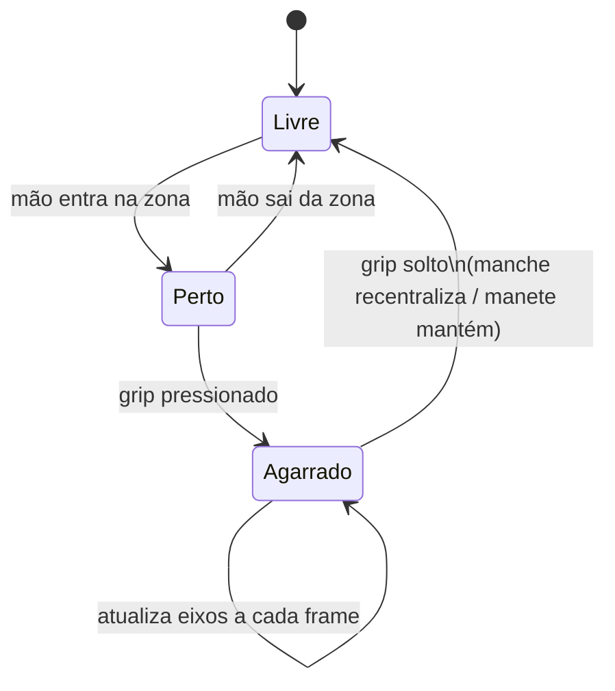

# Pilar 2 – Manche e Manete com os Controles do Quest 3

## Objetivo
Pilotar com as mãos: segurar um **manche virtual** e uma **manete virtual** usando os controles Touch Plus do Quest 3, com feedback háptico e um conjunto de **popups e camadas de debug** ligáveis.

## Como funciona
1. O Companion lê poses e botões dos controles via SteamVR (app de overlay).
2. Ao apertar o **grip** perto da zona de um controle virtual, a mão "agarra" esse controle.
3. O movimento da mão é convertido em valores de eixo e enviado ao IL-2 como um **joystick vJoy**.
4. A telemetria do jogo alimenta a háptica (Fase 3).

## Manche (mão direita por padrão)

| Parâmetro | Descrição | Padrão |
|-----------|-----------|--------|
| `pivot` | Posição do ponto de rotação no espaço do assento | calibrado no wizard |
| `mode` | `displacement` (posição da mão relativa ao pivot → ângulo) ou `rotation` (rotação do pulso) | `displacement` |
| `throwDeg` | Deflexão máxima que corresponde a 100% do eixo | 20° |
| `deadzone` | Zona morta central | 2% |
| `curve` | Exponencial / pontos customizados | expo 0.3 |
| `smoothing` | Filtro One-Euro (minCutoff, beta) | 1.0 / 0.05 |
| `onRelease` | `center` (volta ao centro em t ms) ou `hold` | `center` 150 ms |
| `trim` | Thumbstick altera offset de pitch/roll | habilitado |

**Leme:** thumbstick X da mão do manche **ou** torção do pulso (twist) – configurável.
**Botões:** gatilho → armas primárias; A/B → armas secundárias/bombas; tudo remapeável para botões vJoy.

## Manete (mão esquerda por padrão)

| Parâmetro | Descrição | Padrão |
|-----------|-----------|--------|
| `zone` | Caixa de agarre no espaço do assento | calibrada |
| `axis` | Direção do curso (frente/trás) e comprimento | 15 cm |
| `detents` | Pontos com "clique" háptico (ex.: 100%, WEP) | `[1.0]` |
| `onRelease` | Mantém valor | `hold` |
| `thumbstickMode` | Alternativa: thumbstick Y incrementa/decrementa | desligado |

Botões da mão da manete: X/Y e thumbstick podem acionar flaps, trem, zoom, etc. (via teclas ou botões vJoy).

## Mapeamento vJoy padrão

| vJoy | Função IL-2 |
|------|-------------|
| X | Roll (aileron) |
| Y | Pitch (profundor) |
| Rz | Yaw (leme) |
| Z | Throttle |
| Rx, Ry, Sl0, Sl1 | Reservados p/ alavancas do Pilar 3 (mistura, passo, radiador...) |
| Botões 1–32 | Gatilhos, botões dos controles, ações de cockpit |

## Popups e camadas de debug

Cada camada é independente, tem atalho próprio e pode ser exibida no **VR** (overlay preso à mão, ao assento ou ao HMD) e/ou na **janela desktop**.

| Camada | Conteúdo | Ancoragem padrão |
|--------|----------|------------------|
| `axes` | Barras de pitch/roll/yaw/throttle (valor bruto vs. pós-curva) + cruz XY | pulso esquerdo |
| `input` | Estado bruto: botões, gatilhos (0–1), thumbsticks, toque capacitivo | desktop |
| `gizmos` | Pivot do manche, zona da manete, eixo de curso, linha mão→pivot | assento |
| `grab` | Estado da máquina (Livre/Perto/Agarrado) por mão | mão |
| `haptics` | Últimos pulsos emitidos (canal, intensidade, duração) | desktop |
| `telemetry` | Valores ao vivo da telemetria | desktop |
| `perf` | Frame time do loop, idade da última pose, taxa de UDP | desktop |
| `events` | Log rolante de eventos (grab, release, binds disparados) | desktop |

Atalho para o gerenciador de camadas: `Ctrl+Alt+F1`; camadas individuais `Ctrl+Alt+F2…F9`. Menu rápido no VR: segurar o botão **Menu** do controle esquerdo abre um popup radial para ligar/desligar camadas.

## Wizard de calibração
1. "Coloque a mão direita onde quer a empunhadura do manche e aperte o gatilho."
2. "Mova a mão para frente, como empurrando o manche ao máximo, e aperte o gatilho." → define `throwDeg`/eixo.
3. "Coloque a mão esquerda na manete em marcha lenta (gatilho) e depois em potência máxima (gatilho)." → define `zone` e `axis`.
4. Pré-visualização com camada `gizmos` ligada; salvar.

## Critérios de aceite
- Decolar, fazer um circuito e pousar sem HOTAS.
- Soltar o manche o recentraliza; soltar a manete mantém a potência.
- Nenhum tremor visível no eixo com a mão parada (camada `axes`).
- Todas as camadas ligam/desligam por atalho e persistem entre sessões.
