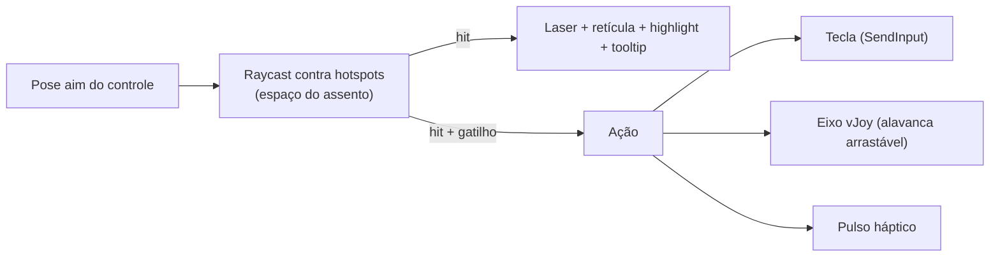

# Pilar 3 – Interação com Painéis e Controles do Cockpit

## Objetivo
Apontar para interruptores, alavancas e botões do cockpit com os controles VR, **ver a interação** (laser, retícula, destaque) e acionar a função correspondente no IL-2.

## Ideia central: "hotspots invisíveis" sobre o cockpit do jogo

O IL-2 GB não tem cockpits clicáveis nem expõe a geometria do cockpit. A solução:

1. **Hotspots**: volumes simples (caixa, esfera, retângulo) definidos por aeronave, no **espaço do assento** (o mesmo alinhado pelo Pilar 1). Cada hotspot fica sobreposto ao controle visível no cockpit renderizado pelo jogo.
2. **Raycaster**: um raio sai da pose *aim* do controle; o hotspot mais próximo atingido é selecionado.
3. **Feedback visual** via overlays do SteamVR: laser, retícula no ponto de impacto, contorno/brilho no hotspot e tooltip com o nome ("Trem de pouso – Recolher").
4. **Ação**: ao apertar o gatilho, o Companion envia ao jogo a tecla ou eixo vJoy mapeado.
5. **Háptica**: pulso curto ao entrar num hotspot e ao acionar.



## Tipos de ação

| Tipo | Comportamento | Exemplo |
|------|---------------|---------|
| `tap` | Pressiona e solta uma tecla/combo | Trem de pouso (toggle no jogo) |
| `hold` | Mantém pressionado enquanto o gatilho estiver apertado | Partida do motor, freio |
| `toggle` | Alterna estado interno e envia teclas diferentes (on/off) | Luzes de navegação |
| `rotary` | Girar o pulso / thumbstick envia teclas +/− repetidas | Trim, flaps incrementais |
| `lever` | Agarrar e arrastar ao longo de um eixo → valor contínuo num eixo vJoy | Mistura, passo da hélice, radiador |
| `sequence` | Lista de teclas com atrasos | Procedimento de partida |

## Modos de interação

| Modo | Descrição |
|------|-----------|
| **Laser** (padrão) | Raio longo, seleção por mira; bom para painéis distantes |
| **Toque** | Seleciona o hotspot mais próximo da ponta do controle (raio < 3 cm); mais imersivo para alavancas ao alcance |
| **Painel proxy** | Painel 2D flutuante com botões das funções da aeronave; não requer calibração (fallback/onboarding) |

## Editor de hotspots (in-VR)

- **Criar**: apontar e apertar → cria hotspot na distância atual do laser (ajustada com thumbstick).
- **Triangular** (precisão): apontar para o mesmo knob de duas posições diferentes; o ponto 3D é o ponto médio da menor distância entre os dois raios.
- **Mover/redimensionar**: agarrar com grip; thumbstick altera tamanho.
- **Atribuir ação**: menu popup com lista de ações conhecidas do IL-2 (pré-carregada) + campo de tecla.
- **Camada `hotspots`**: mostra todos os volumes com ids, para depuração.
- Perfis exportáveis/compartilháveis (JSON) – a comunidade pode contribuir com cockpits.

## Modelo de dados (resumo)

Ver [config/examples/cockpit.lagg3s29.example.json](../../config/examples/cockpit.lagg3s29.example.json).

```jsonc
{
  "id": "gear_toggle",
  "label": "Trem de pouso",
  "shape": { "type": "box", "size": [0.04, 0.03, 0.03] },
  "pose":  { "position": [-0.28, -0.35, -0.42], "yawPitchRollDeg": [0, -20, 0] },
  "action": { "type": "tap", "keys": ["LCtrl", "G"] },
  "haptics": { "onHover": "tick", "onActivate": "click" }
}
```

## Critérios de aceite
- Em 1 aeronave de referência, ≥ 10 hotspots acionáveis com taxa de acerto ≥ 95% em teste de 50 acionamentos.
- O laser e o highlight acompanham o controle sem atraso perceptível.
- Após recentralizar pelo Pilar 1, os hotspots continuam alinhados com o cockpit.

## Questões em aberto
- Alavancas `lever`: quais controles do IL-2 aceitam eixo (mistura, passo, radiador, trim) por aeronave?
- Auto-detecção da aeronave: a telemetria expõe o tipo? (S5) – senão, seleção manual/atalho.
- Uso de render models do OpenVR para desenhar uma "mão" ou o controle dentro do cockpit.
